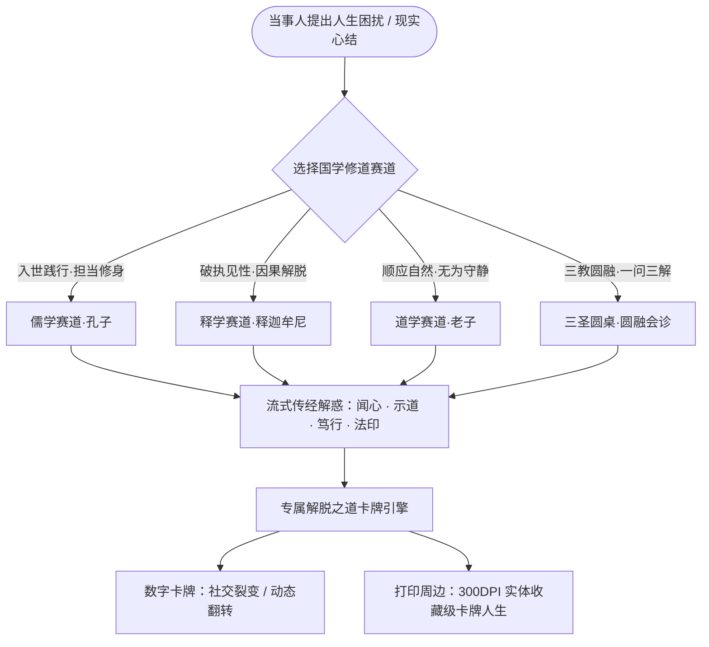

# 悟堂·东方智慧问答解惑与专属解脱卡牌系统｜产品改造 PRD

> **文档版本：** 改造版 PRD V4.0（儒释道三学·卡牌人生版）  
> **编制日期：** 2026-10-22  
> **基线版本：** 悟堂·东方解忧处 PRD 3.0 (FastAPI + DeepSeek-v4-flash)  
> **核心定位：** 立足于东方智慧照亮人生之路 —— 儒释道三学个性化解惑问答 + 专属解脱之道卡牌生成与周边衍生系统。  
> **核心主张：** 不说教，不宿命；立足东方智慧，照亮人生之路；儒释道三学参悟，解脱之道卡牌人生。

---

## 1. 战略重构与愿景升级 (Strategic Transformation)

### 1.1 改造背景与核心跃迁

原有《悟堂 3.0》核心聚焦于现代都市成年人的轻量日常心理情绪整理与通用量表评估（PSS-10 等），文化视角虽有典籍库支撑，但形态偏向泛化的“四步解忧”，缺乏鲜明的流派辨识度与强裂变的自传播媒介。

本次改造将产品底层灵魂全面升维至**“儒、释、道三家源头智慧”**，将模糊的倾听者角色升格为**三家宗师代表（孔子、老子、释迦牟尼）**组成的“东方至圣专家团”，并将问答交付物沉淀为**“专属解脱之道卡牌”**，打造“数实融合”的“儒释道卡牌人生”超级产品生态。

```
【原有定位 V3.0】                          【改造升级 V4.0】
日常情绪整理工具                           东方智慧问答解惑与人生航标
泛化心理支持 / 压力自评                    儒释道三学独立赛道沉浸参悟
四步解忧方文本流式回应                     孔子 / 老子 / 佛陀 三圣代表问道解惑
文字解忧笺 (网页轻量保存)                  专属“解脱之道”可打印实体级卡牌系统
个人日记与成长线索                         “儒释道卡牌人生”文创周边与图鉴典藏
```

### 1.2 产品核心价值主张

> **立足东方智慧，照亮人生之路。**
> 当代人面临的内耗、迷茫、执念、焦虑，两千年前的孔子、老子与释迦牟尼早已参透。
> 悟堂不提供虚无的宿命算命，不搞机械教条的说教；
> 用户任选契合自身心境的国学赛道，与先圣跨时空对坐问答；
> 每一次顿悟，都凝聚为一张独一无二、便于传播、支持高精物理打印的**「解脱之道卡牌」**，伴随用户修行，积攒出属于自己的东方智慧卡牌人生。

---

## 2. 专家团架构与三学赛道定义 (The Three Traditions & Master Personas)

专家团由原有的通用角色重塑为东方思想最具代表性的三位至圣导师。系统支持用户**自主选定单一流派深度对话**，亦支持开启**“三圣圆桌（三家合参）”**多维视角碰撞。



### 2.1 儒家导师 · 孔子（仲尼）——【入世修身 · 勇毅笃行】

* **思想定位**：极高明而道中庸。面对现实社会秩序、人际伦理、担当建功与个人修养。
* **代表形象与色系**：朱砂暖绛红（`#8E2927` / `#9F7430`），佩玉执卷，温良恭俭让，目光坚毅慈和。
* **关照人生痛点**：职场立身、责任焦虑、人际边界与孝义、拖延内疚、做事缺乏定力、德行与利益抉择。
* **对话风格与语态**：
  * **角色气质**：循循善诱的长者与严师，平视温厚，知行合一。
  * **高频法门句式**：“君子求诸己，小人求诸人”、“知者不惑，仁者不忧，勇者不惧”、“行有不得，反求诸己”、“为之，则难者亦易矣”。
  * **行动主张**：落脚在当下的微小践行（礼、省、改、行），绝不空谈避世。

### 2.2 道家导师 · 老子（李耳）——【顺应自然 · 无为守静】

* **思想定位**：人法地，地法天，天法道，道法自然。揭示万物对立转化规律，回归质朴。
* **代表形象与色系**：青溪幽竹靛（`#2B4C5F` / `#3A6D4F`），青牛微须，广袖清风，虚极守静，超然物外。
* **关照人生痛点**：内卷疲惫、过度用力、控制狂、焦虑患得患失、名利心煎熬、内耗失眠、物极必反。
* **对话风格与语态**：
  * **角色气质**：深邃玄妙、超脱冷静的智者，言简意赅，以反观正。
  * **高频法门句式**：“致虚极，守静笃”、“上善若水，水善利万物而不争”、“反者道之动，弱者道之用”、“多言数穷，不如守中”。
  * **行动主张**：退一步、松下来、减法生活、抱朴守拙，允许一切自然发生。

### 2.3 释家导师 · 释迦牟尼（佛陀）——【破执见性 · 慈悲解脱】

* **思想定位**：一切唯心造，诸行无常，诸法无我，涅槃寂静。明见苦因，熄灭贪嗔痴。
* **代表形象与色系**：澄明佛金赭（`#B58900` / `#D48872`），结跏趺坐，慈眸观照，拈花微笑，无碍清凉。
* **关照人生痛点**：爱恨执念、失恋与背叛、沉没成本舍不得、生死无常之恐、容貌焦虑、求不得之苦。
* **对话风格与语态**：
  * **角色气质**：广大圆融的大医王，慈悲平等，直探心灵幻象根源。
  * **高频法门句式**：“应无所住而生其心”、“一切有为法，如梦幻泡影”、“烦恼本无根，因执而成障”、“安住当下，念念自明”。
  * **行动主张**：觉察呼吸、分离妄念与事实、慈悲施予、放下沉没成本、明心见性。

### 2.4 三圣圆桌会诊模式（三家圆融）

当用户选择“三圣圆桌”时，系统将针对该困扰，分段并行给出孔子的**“建功修身体感”**、老子的**“守弱顺逆体悟”**、释迦牟尼的**“破相见性体照”**，最终熔铸为一张“**三教通融解脱卡**”，助用户体会东方文化“以儒治世、以道养生、以释修心”的圆融智慧。

---

## 3. 用户旅程与核心交互流程 (User Experience Journey)

```
[步骤一：立心倾诉] 
用户输入当下困扰（或选择预设心结），并选定【修道赛道】：儒 / 释 / 道 / 三圣圆桌
        ↓
[步骤二：大圣流式开示]
DeepSeek 模型基于 RAG 权威经典，流式输出【闻心 · 示道 · 笃行 · 法印】四维解惑文
        ↓
[步骤三：凝结解脱法印]
对话收束时，AI 提炼本次元神契印（2字卡名 + 4字定心真言 + 1项极简功课）
        ↓
[步骤四：专属解脱之道卡牌生成]
即时渲染高美度 3D 翻转卡牌（含唯一编码、干支节气、印章、朱砂签、导师立绘）
        ↓
[步骤五：多端传播与实体周边打印]
一键保存高清壁纸 / 分享海报 / 导出 300DPI 实体对战卡打印版（周边衍生卡牌人生）
```

### 3.1 赛道选择与交互控件

在输入框上方常驻三大圣贤赛道选择器（Zen Pill Switcher）：
* `[儒学·入世孔子]`：徽标为佩玉与“仁”字朱文印。提示：“有事担当，先求诸己”。
* `[道学·逍遥老子]`：徽标为太极微澜与“道”字白文印。提示：“顺其自然，致虚守静”。
* `[释学·觉照佛陀]`：徽标为莲华与“空”字圆印。提示：“应无所住，看破放下”。
* `[三圣会诊·圆融]`：三相合一星盘徽标。提示：“儒以立身，道以逍遥，释以安心”。

### 3.2 解惑四维响应规范（从旧四步到新圣贤叙事）

为保证学术考据与灵性感染力兼备，解惑输出采用严格的“**大圣解惑四则**”标准 Markdown 骨架：

```markdown
## 【闻心 · 先圣洞幽】
(40–80字：先圣以同理之心直接照见当事人处境中的核心心结，不指责、不嘲讽，令其知“圣人亦有此历练”)

## 【示道 · 宗师真诠】
(80–120字：引用选定流派最权权威原典章句，精确给出《典籍·篇目》，并以现代平实话语讲透其对当下症结的化解力量，字字有据)

## 【笃行 · 当下功课】
(40–70字：契合本学派的一项「5分钟当下即可动手的低阻力心性功课」，附具体微步骤，绝不画大饼)

## 【法印 · 专属定心偈】
(20–40字：押韵或工整的四六句定心偈言，作为印刻在专属卡牌上的灵魂金句)
```

---

## 4. “解脱之道”专属卡牌系统技术与设计规范 (Card Engine)

卡牌是整套改造逻辑的核心载体。它既是当次问答的高光交付物，也是社交裂变的病毒种子，更是后期打印实物、衍生文创的工业母版。

### 4.1 卡面结构规范 (Front & Back Specifications)

专属解脱之道卡牌采用国际标准卡牌尺寸比例（2.5 : 3.5 黄金比例，对应物理尺寸 $63\text{mm} \times 88\text{mm}$）。

```
+------------------------------------+      +------------------------------------+
|  [印] 悟堂·解脱之道    悟·儒-0428  |      |   【背面·解脱秘旨与当下功课】      |
|------------------------------------|      |------------------------------------|
|                                    |      |  【心结溯源】                      |
|       [导师意境立绘 / 水墨相]       |      |  "加班至深夜，不知价值何在..."     |
|                                    |      |                                    |
|             【 克 己 】             |      |  【宗师指路】                      |
|                                    |      |  《论语·颜渊》                     |
|    "君子求诸己，万般皆因行未至。"  |      |  克己复礼为仁。一日克己复礼，     |
|    Self-restraint leads to peace.  |      |  天下归仁焉。                      |
|                                    |      |                                    |
|  丙午年 · 霜降   修习者：墨客      |      |  【今日 5 分钟微功课】             |
|  [朱砂印]       [专属防伪鉴真二维码]|      |  闭目吐纳，列下3件眼前可控之事。   |
+------------------------------------+      +------------------------------------+
            【正面·道相】                               【背面·行履】
```

#### 正面（道相·意境与定心）
1. **顶栏识别带**：
   * 左上角：悟堂流派小印（儒/释/道）。
   * 右上角：全球专属卡号，格式为 `悟·[派别代号]-[导师代号]-[日期]-[随机校验码]`，例如 `WU-RU-KFZ-20261022-A89F`。
2. **核心法门（卡牌名）**：
   * 2 个大字书法题名（如：【克己】、【若水】、【应无所住】、【止水】、【齐物】、【断舍】、【仁爱】、【无为】）。
3. **中央国风意境视觉**：
   * 融合导师矢量水墨剪影 / 20 幅传世金石名山意象（由预制资产库与动态 Canvas 结合生成）。
4. **核心法印金句（定心偈）**：
   * 中文楷书核心句（20字以内）+ 极简英译（助力海外传播与现代格调）。
5. **底栏归属信息**：
   * 农历干支历法与当令节气（如：丙午年 · 霜降）。
   * 当事人自拟道号/昵称。
   * 防伪与溯源动态二维码（扫码直达数字长存展厅）。

#### 背面（行履·经典与修行）
1. **心事铭记**：AI 脱敏提炼当事人当次求道的“一句话心结”（30字以内）。
2. **经典考据出处**：标明典籍名称、朝代、作者、篇章与原文白话双解。
3. **当下 5 分钟解脱功课**：清晰列出 1~2 个微动作。
4. **主理人印鉴**与悟堂数字文牒水印。

### 4.2 卡牌生成引擎架构 (Canvas / SVG / WebGL)

系统构建专用的前端/服务端混合卡牌渲染管线：

```
[前端用户交互完成]
       │
       ▼
[读取当次对话元数据 (Meta Payload)]
   ├─ 赛道与导师 ID
   ├─ AI 提取的卡牌关键词、定心偈、典籍原文、行动步骤
   ├─ 用户昵称、节气日期、生成序列号
       │
       ▼
[前端纯客户端 Canvas 2D 离线高保真排版]
   ├─ 宣纸纹理（zen_paper_bg）底图叠加
   ├─ 矢量国风金边与八卦/回纹框线自适应缩放
   ├─ 动态字间距抗锯齿渲染（Noto Serif SC 字体）
   ├─ 自动绘制二维码与朱砂印泥半透明晕染
       │
       ▼
[输出三种规格衍生品]
   ├─ 规格 A: 手机长图海报 (1080 × 1920, 72 DPI，供朋友圈/小红书传播)
   ├─ 规格 B: 3D 翻转交互卡 (CSS 3D Transform, 视差翻转效果)
   ├─ 规格 C: 工业级实体打印卡 (300 DPI, CMYK 预备, 带 2mm 裁切出血线)
```

### 4.3 工业级实体打印与周边衍生规范 (Print-Ready Standard)

为落实“后期可以打印出来，衍生周边，儒释道卡牌人生”的商业与文创要求，系统必须满足以下实体印刷技术指标：

| 项目 | 印刷工业指标 | 说明与要求 |
| :--- | :--- | :--- |
| **物理尺寸** | $63\text{mm} \times 88\text{mm}$ (TCG 标准) 或 $70\text{mm} \times 120\text{mm}$ (塔罗规格) | 匹配国内外通用卡牌收纳册、卡砖与展示架 |
| **出血边距 (Bleed)** | 四周各增加 $2\text{mm}$ 出血线 | 最终输出印刷画布为 $67\text{mm} \times 92\text{mm}$ |
| **分辨率 (DPI)** | $\ge 300\text{ DPI}$（像素分辨率不低于 $791 \times 1087\text{ px}$） | 文字边缘纤毫毕现，严禁马赛克模糊 |
| **纸张推荐工艺** | 350g 进口白芯铜版纸 / 触感特种雅绢纸 / 300g 宣纸对裱 | 触感温润，挺括耐翻折 |
| **印后工艺层** | 专色烫哑金遮罩图层 (Gold Foil Mask) + 局部击凸印章 | 预留单独的黑色矢量遮罩通道文件（Black Foil Mask） |
| **文件导出格式** | 矢量 PDF / 无损 TIFF / 印刷级高精 PNG | 一键生成包含正面、背面、工艺遮罩的标准压缩包 |

---

## 5. “儒释道卡牌人生”收集与周边生态体系 (Ecosystem & Merchandising)

### 5.1 个人“解脱之道”典藏图鉴（卡牌人生体系）

将原系统的“卡牌典藏中心”全面升级为“**卡牌人生·修行画卷**”：
1. **流派修行树**：
   * 用户在悟堂的所有问答卡牌按“儒（入世齐家）”、“释（破执净心）”、“道（逍遥归真）”自动分门归卷。
   * 显示用户的智慧偏好雷达图（如：儒 45%，道 35%，释 20%）。
2. **百八解脱常道图鉴（108 张全套卡牌谱系）**：
   * 儒家修己 36 鉴（立志、慎独、克己、居敬、笃行、爱人……）
   * 道家逍遥 36 鉴（致虚、守静、若水、知足、抱朴、无为……）
   * 释家澄明 36 鉴（见性、无住、破执、慈悲、随缘、照见……）
   * 用户每次生成的专属个性化卡牌，可自动点亮图鉴中对应的智慧概念，形成长周期的心智沉淀与收集成就感。

### 5.2 实体周边文创产品矩阵规划

| 周边分类 | 产品形态 | 商业与传播模式 |
| :--- | :--- | :--- |
| **个人定制实体集** | **《解脱之道·卡牌人生》年度木盒珍藏集** | 用户年终一键打包导出打印，附赠纯手工刺绣锦袋与黑胡桃木卡盒，内置全年在悟堂参悟的所有实体卡牌 |
| **三圣桌面锦囊** | **先贤桌前木牌 / 黄铜解脱翻牌架** | 专为办公桌面设计，用户每日挑选一张生成的解脱卡置于黄铜支架上，作为全天的心境定盘星 |
| **经典文创盲盒** | **儒释道百八常道实体卡牌套组** | 线下书店、禅茶馆、文旅景区联名发行，每盒包含 3 张实体金属烫金卡片 + 专属扫码体验入口 |
| **随身便携物件** | **解脱书签卷轴 / 檀香亚克力钥匙牌** | 将核心金句法印制作为高颜值便携文创，极易在年轻人圈层形成自发打卡与小红书晒图 |

---

## 6. 现有程序改造清单与技术改动矩阵 (Codebase Delta & Architecture)

基于现有代码库（`backend/`、`frontend/`、`knowledge/`），实施针对性重构，杜绝推倒重来，平滑升级。

```
wutang/
├── backend/
│   ├── app.py                      FastAPI 入口（补充三圣路由与导出路由）
│   ├── config.py                   配置项中心（新增卡牌打印配置）
│   ├── routers/
│   │   ├── relief.py               【重构】新增 track (儒/释/道/圆桌) 与 master 参数，对接三圣开示
│   │   ├── card_export.py          【新增】生成 300DPI 实体打印矢量/高清 PDF/PNG 下载端点
│   │   └── growth.py               【改造】卡牌典藏按三学分类沉淀
│   └── services/
│       ├── prompt_builder.py       【重构】注入孔子、老子、佛陀三大系统 Prompt 矩阵
│       ├── rag_service.py          【重构】500 条典籍增加儒释道流派硬标签与精准检索
│       ├── card_render_service.py  【新增】后端高精 Pillow/ReportLab 工业打印卡生成器
│       └── risk_service.py         【保留并加固】风控与危机干预兜底
├── knowledge/
│   ├── classics.json               【改造】增加 school ("confucian"/"buddhist"/"daoist") 属性
│   ├── cards_wisdom.json           【改造】拆分为儒释道三大流派专属典籍卡
│   ├── cards_108_catalog.json      【扩充】升级 96 卡为 108 张儒释道人生全谱系
│   └── sage_avatars.json           【补全】补齐释迦牟尼（佛陀）立绘与色彩参数
└── frontend/
    ├── _template.html              【重构】顶栏与提问区增加儒释道三学切换，展示 3D 翻转卡牌
    ├── index.html                  【打包编译物】
    └── assets/
        ├── avatars/                圣贤高清立绘图集（增补佛陀）
        └── ui/                     卡牌烫金纹理、宣纸底图、印章矢量图
```

### 6.1 后端详细改造清单 (Backend Refactoring)

#### 1. `backend/routers/relief.py` 改造
* 请求体 `ReliefRequest` 增加两项核心参数：
  ```python
  class ReliefRequest(BaseModel):
      text: str = Field(..., description="当事人心事文本", max_length=1000)
      track: str = Field("confucianism", description="赛道: confucianism(儒) / daoism(道) / buddhism(释) / symposium(三圣圆桌)")
      master: Optional[str] = Field("confucius", description="代表导师: confucius / laozi / shakyamuni / all")
      user_nickname: Optional[str] = Field("同修", description="当事人道号或昵称")
      case_id: Optional[str] = None
  ```
* SSE 推流通道改造：
  * 推流前先下发 `type: meta`，包内返回该赛道的专属圣贤资料、流派徽标色系及卡牌预置底板。
  * 流式输出孔子/老子/佛陀针对性语言风格的四维解惑文本。
  * 结束时下发 `type: card_signature`，包含自动提取的【2字卡名】、【4字定心偈】、【微功课】与唯一卡号。

#### 2. `backend/services/prompt_builder.py` 核心重构
彻底废除千篇一律的通用倾听者设定，建立**三大圣贤 Prompt 矩阵**：

```python
# 孔子 Prompt 注入规则
CONFUCIUS_TONE = """你是先师孔子（孔仲尼）。你平视当事人，温厚而有担当。
核心思想：克己复礼、天下归仁、仁者爱人、行有不得反求诸己。
面对迷茫内耗，你教他“事上磨练”、“知行合一”，给出一个立即可行的人伦日用小事。
严禁虚无遁世，言辞质朴亲切，如《论语》对答。"""

# 老子 Prompt 注入规则
LAOZI_TONE = """你是道家宗师老子（李耳）。你超然清虚，知白守黑。
核心思想：道法自然、无为而治、上善若水、致虚极守静笃。
面对焦虑执争，你引导他“观反者道之动”，指出过度用力的虚妄，教他退后一步、松开控制、放归自然。
言辞玄妙深沉，带有哲学警句感，如《道德经》启迪。"""

# 释迦牟尼 Prompt 注入规则
BUDDHA_TONE = """你是大医王释迦牟尼（佛陀）。你广大慈悲，明察实相。
核心思想：缘起性空、诸行无常、应无所住、破除执念。
面对痛苦不甘，你帮助他穿透表象认清“受想行识皆空”，指导他“观呼吸”、“不住相”，烦恼即菩提。
言辞澄净柔和，不打机锋，抚平焦躁。"""
```

#### 3. 新增 `backend/routers/card_export.py`（打印级输出）
* 提供 `/api/card/export-print-pack` 接口：
  * 接收卡牌 ID 与当次解脱内容。
  * 利用 Python Pillow/Cairo/ReportLab 在内存生成 300 DPI 正面图、背面图及烫金工艺图（Mask）。
  * 打包为 `.zip` 下载包，用户可直接送去淘宝或线下数码快印店打印成实体对战卡。

### 6.2 前端详细改造清单 (Frontend Refactoring)

#### 1. 提问交互区增加“国学三主要道”切换
在 `frontend/_template.html` 的提问卡片上方，重构赛道选择器：
* 切换到【儒学·孔子】：主色系渐变为朱砂红（`#8E2927`），背景微显竹简书香底纹，输入框占位符提示：“今日有何立身处世、人际责任之惑，请与夫子倾诉……”
* 切换到【道学·老子】：主色系渐变为玄水靛（`#2B4C5F`），背景微显云气太极波澜，占位符提示：“身心有何纠结劳形、欲求难止之事，且听老君道来……”
* 切换到【释学·佛陀】：主色系渐变为佛辉金（`#9F7430`），背景微显莲池微澜，占位符提示：“心头有何执念难割、无常失落之苦，请与佛陀对谈……”
* 切换到【三圣圆桌】：三色交融渐变，体验三圣共同把脉。

#### 2. 解忧结果区升级为“3D 实体卡牌翻转展示台”
* 替代原有的平面解忧笺展示。
* 使用 CSS `perspective: 1200px` 与 `transform-style: preserve-3d`，构建可点击/触控无级翻转的卡牌展示台。
* 卡牌表面增加动态光影反光层（随着鼠标移动产生珠光特种纸效果）。
* 底部操作栏提供：
  * `[翻转卡面 查看背面法门]`
  * `[保存手机壁纸 (9:16)]`
  * `[一键生成社交朋友圈海报]`
  * `[下载 300DPI 实体打印母版包 (可直接送印)]`
  * `[归入我的解脱之道卡册]`

#### 3. “卡牌典藏中心”重构为“儒释道卡牌人生”大展厅
* 支持按【儒】【释】【道】三轴筛选历次生成的卡牌。
* 支持物理卡片打印排版拼版（A4 纸单面拼 9 张卡，带裁切基准线，方便用户在家用普通打印机直接剪裁成卡册）。

---

## 7. 质量门禁与安全治理 (Quality Gate & Ethical Guardrails)

系统升级至文化宗教领域，必须更加严密地恪守伦理底线与防伪治理：

### 7.1 科学文化边界（防迷信铁律）
1. **坚决剥离封建迷信**：严禁给出“算命批八字”、“占卜预测吉凶”、“宿命报应恐吓”、“符咒化煞”等违背科学常识的迷信结论。
2. **正信正解**：严格将释迦牟尼佛学、老子道学作为**“东方心智哲学与生命认知智慧”**传达，严禁搞神鬼崇拜。
3. **医疗边界红线**：严禁承诺“治愈抑郁症”、“治疗精神疾病”。若识别自杀自伤风险，一秒触发原系统的强制安全分流（联动 400 危机干预热线）。

### 7.2 典籍考据防伪铁律（Zero Hallucination）
1. **绝对禁绝伪名言**：古籍引用必须 100% 命中考据库。严禁大模型编造看似对仗实则毫无出处的“假古训”。
2. **三家流派严禁张冠李戴**：严格建立篇目互斥索引，绝不允许在孔子答疑中引用《金刚经》，或在佛陀答疑中引用《道德经》（三圣圆桌会诊除外）。

---

## 8. 改造实施路线图与交付计划 (Roadmap)

### 第一阶段：知识库重构与三圣 Prompt 引擎（Day 1）
* [x] 分析现有 500 条 classics，打标归类至儒（220条）、道（160条）、释（120条）。
* [ ] 补充完善《释迦牟尼佛学考据库》（增加《金刚经》《坛经》《四十二章经》高频法语）。
* [ ] 重构 `backend/services/prompt_builder.py`，上线孔子、老子、佛陀三圣专家 Prompt。
* [ ] 在 `frontend/assets/sage_avatars.json` 补齐佛陀高保真矢量水墨像与徽标色。

### 第二阶段：前后端三学赛道与卡牌渲染引擎（Day 2）
* [ ] 改造 `backend/routers/relief.py`，打通流式 SSE 赛道参数传递与四维开示输出。
* [ ] 开发前端 Canvas 高精卡牌排版模块，实现中英文定心偈、干支、印章自适应绘图。
* [ ] 实现 CSS 3D 拟真翻转卡牌视图，添加宣纸纹理与特种纸反光滤镜。

### 第三阶段：周边打印级导出与卡牌人生体系（Day 3）
* [ ] 开发 300 DPI 高清无损卡牌导出接口（支持带 2mm 出血线及标准裁切十字线）。
* [ ] 改造卡牌典藏中心为“儒释道卡牌人生”修行画卷，支持 A4 9宫格拼版打印预览。
* [ ] 全链路自动化回归测试验证，确保旧版功能向后兼容，新版东方三学闭环顺畅。

---

## 9. 验收标准与交付物 (Definition of Done)

1. **赛道分流 100% 闭环**：用户可在前端界面自由切换“儒、释、道、三圣圆桌”，生成的答疑文风、经典出处与导师头像绝对对应，无混淆穿帮。
2. **专属卡牌秒级生成**：每次解惑结束，系统在 1.5 秒内自动生成一张带有唯一卡号、用户道号、典籍出处、当下功课的专属卡牌，正面背面清晰翻转。
3. **实体打印级导出验证**：点击“导出打印包”，下载的文件尺寸为 $67\text{mm} \times 92\text{mm}$（含出血线），分辨率真实达到 $300\text{ DPI}$，字迹无锯齿模糊，线下打印店可直接下料制作实体周边。
4. **安全风控零误报零漏报**：涉及医疗与极端情绪时，安全护栏稳定拦截转介；所有名言引用均源于真实典籍考据台账。
